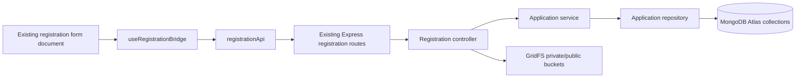

# Registration architecture

## Scope

This pass preserves the existing embedded form document, visible copy, field ordering, option lists, registration type names, success behavior, and API URLs. Persistence now targets Atlas and GridFS; an idempotent startup migration copies legacy data without deleting its source records.

## Current module map

```text
client/src/RegistrationPortal.jsx                 iframe host only
client/src/features/registration/
  config/registrationTypes.js                     role and form ID mapping
  hooks/useRegistrationTheme.js                   theme token bridge
  services/registrationApi.js                     API boundary
  registration-document.js                        source document + runtime assembly
  useRegistrationBridge.js                        iframe messages, validation feedback, submit state
server/src/app.js                                  middleware and route composition
server/src/modules/registration/
  registration.controller.js                      HTTP-level account/application handling
  registration.service.js                         generic application validation and creation
  registration.repository.js                      Mongoose persistence boundary
server/src/models.js                               existing RegistrationApplication schema
server/src/validation.js                            existing account Zod schema
```



## Preserved integration contracts

- `POST /api/auth/register` still creates the account and session.
- `POST /api/registration-applications` still stores the detailed registration application.
- `POST /api/cadets` and `POST /api/internships` retain their existing dedicated flows.
- Existing routes and registration form markup, fields and labels are unchanged.
- New application records use Atlas collections. Startup idempotently copies prior `cadets`, `registrationapplications`, `internships`, and `galleries` documents to the new collection layout without deleting source records, and migrates available legacy local files into GridFS.
- New uploads use Multer memory storage and GridFS; image data is resized/compressed with Sharp and the per-file request limit is 2 MB. Public gallery files and authenticated private uploads use separate GridFS buckets.
- Aadhaar, PAN, bank-account and IFSC values in detailed application data are AES-256-GCM encrypted before persistence and masked in administrator responses. Income fields remain excluded.
- The member payment path remains simulated; no payment service was introduced.

## Adding a registration field or type

1. Update the existing source form document only when the requested visible form contract changes; update its manifest and contract test in the same change.
2. For a new account type, update the form’s type selector, `registrationTypes.js`, `registerSchema` in `server/src/validation.js`, and any model/admin behavior that consumes it.
3. For a detailed application type, update `registrationTypes.js`, the allowed type and success message in `registration.service.js`, and any upload allowlist.
4. Add a test for visible name/order/required/options, iframe message mapping, server validation, and persistence behavior.
5. Keep sensitive-value filtering and legacy endpoint compatibility in the tests.

## Verification limits and follow-up

- The baseline manifest contract is a Node test because Vitest, Testing Library, jsdom and Playwright are not installed in the current client dependencies; package installation did not complete in the current environment.
- Server tests depend on `mongodb-memory-server`; the baseline run failed while starting its bundled mongod binary (`fassert() failure`) before test cases executed.
- `RegistrationApplication.data` remains a Mixed payload to preserve the existing form contract. The production write path is Atlas/GridFS; no live Atlas connection check or production migration report was run in this editing session.
- Source is JavaScript, so this pass does not introduce TypeScript types or a shared TS package. The current JSON manifest and explicit role maps remain the contracts.
